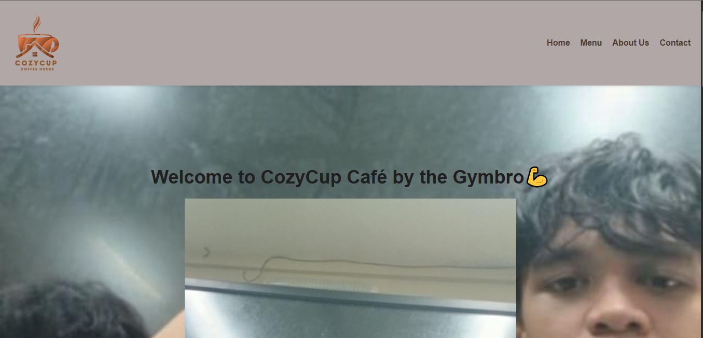
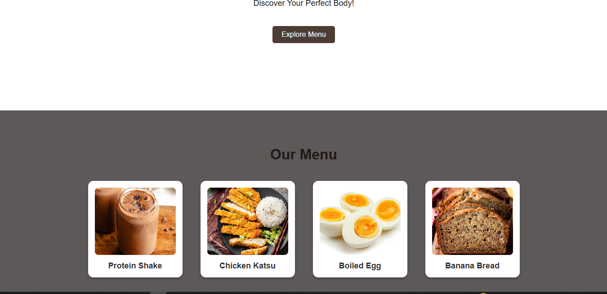
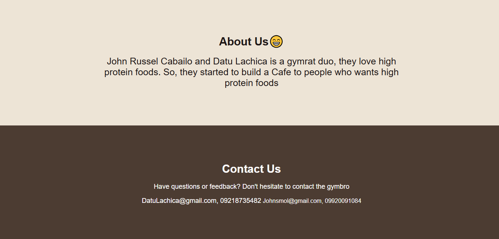

# Project Description
 > Our café offers a wide variety of high-protein shakes and nutritious meals, perfect for those who are health-conscious, fitness enthusiasts, or simply looking for delicious and energizing food options. And that's just the beginning, we have so much more waiting for you!
 # Features
 > * Home 
 > * Menu 
 > * About Us
 > * Contact Us
 # Screen Captures
 
            
            
            

# About to Authors
|   **Name:** John Russel P. Cabailo   **Email:** 202380167@psu.palawan.edu.ph |   **Name:** Datu Herosanib Lachica   **Email:** 202380035@psu.palawan.edu.ph |
|---|---|

  
  

